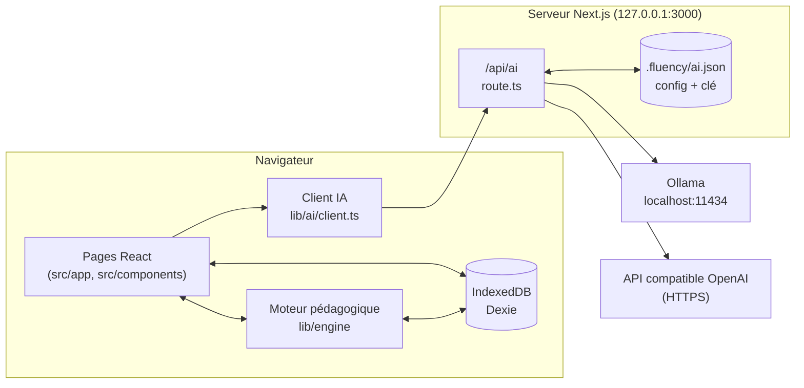
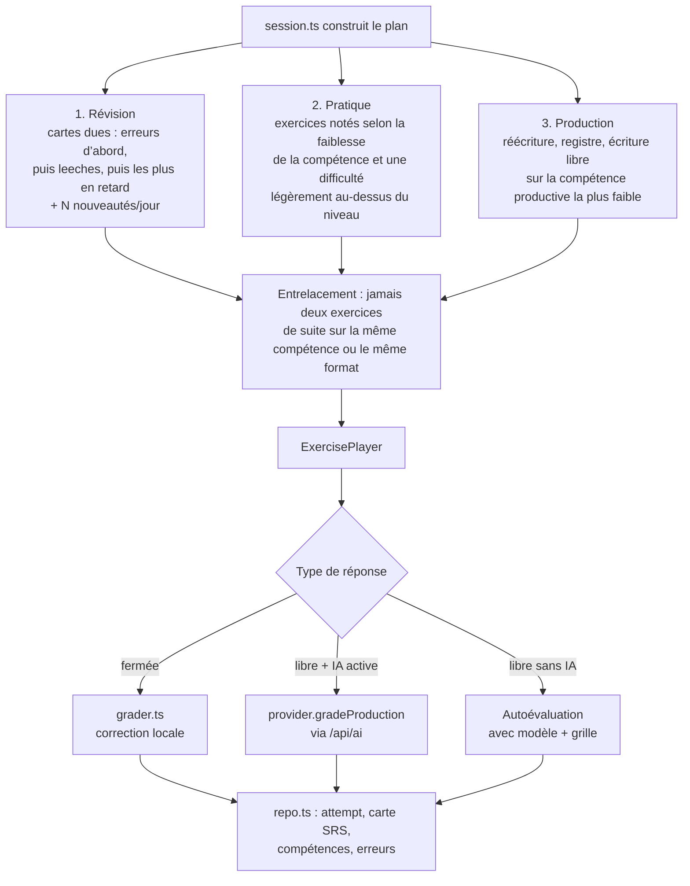
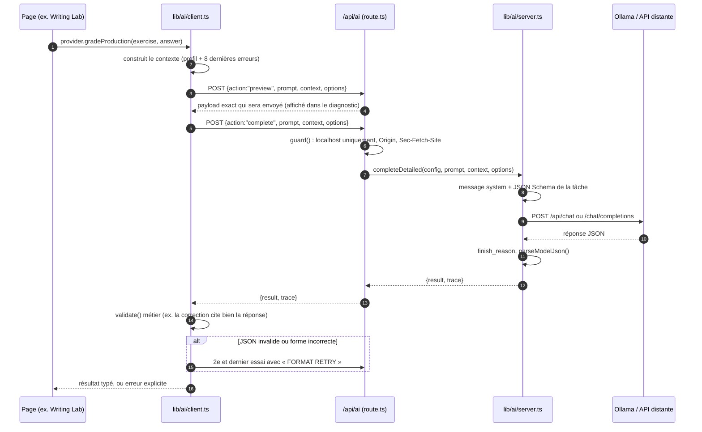

<div align="center">

# Fluency

**Un studio d’anglais personnel, adaptatif et local, pour passer de B2 à C2.**

Révisions espacées, leçons guidées, banque d’erreurs, Writing Lab et IA facultative,<br/>
locale avec Ollama ou distante via n’importe quelle API compatible OpenAI.


[](https://github.com/armand-mlr/fluency/actions/workflows/ci.yml)

[Présentation](#présentation) · [Fonctionnalités](#fonctionnalités) · [Architecture](#architecture-du-projet) · [Fonctionnement](#comment-marche-le-projet) · [IA](#lia-dans-fluency) · [Installation](#installation-pas-à-pas)

</div>

<!-- Présentation vidéo : à ajouter ici -->

---

## Présentation

Fluency est une application web qui tourne **sur votre propre machine** (`http://localhost:3000`). Elle est pensée pour un apprenant francophone de niveau intermédiaire ou avancé (B1 à C2) qui veut gagner en précision : registre, nuances, collocations, phrasal verbs, constructions grammaticales et écriture.

Trois principes guident le projet :

| Principe | Ce que ça veut dire concrètement |
| --- | --- |
| **Local d’abord** | Progression, vocabulaire, erreurs et profil sont stockés dans le navigateur (IndexedDB). Pas de compte, pas de serveur distant, pas de télémétrie. |
| **Utile sans IA** | Tout le contenu (560 fiches, 32 leçons, 255 exercices) est embarqué et corrigé par un moteur déterministe. L’IA est un bonus, jamais un prérequis. |
| **IA transparente** | Quand l’IA est activée, chaque requête est visible dans un panneau de diagnostic : payload exact, réponse brute, durée, tokens. Aucune réponse n’est inventée en cas d’échec. |

Le profil (prénom affiché, niveau actuel, niveau visé, objectifs, centres d’intérêt, durée des sessions) se configure dans **Settings** au premier lancement. Rien n’est lié à un utilisateur en particulier.

## Fonctionnalités

| Page | Rôle |
| --- | --- |
| **Today** | Tableau de bord et session du jour, construite automatiquement : révisions dues, pratique ciblée sur vos points faibles, production écrite. |
| **Leçons** | 32 leçons guidées réparties en 5 parcours (récit, décisions, conversation, écriture, constructions) : règle expliquée en français, exemples traduits, piège commenté, 4 exercices. |
| **Challenge** | Exercices au-dessus de votre niveau (difficulté désirable). |
| **Vocabulary** | 560 fiches B1 à C2 en 12 collections, filtres par niveau, type et registre, import JSON, enrichissement IA. |
| **My mistakes** | Chaque erreur est enregistrée avec son explication, puis revient dans les révisions sous d’autres formes jusqu’à ce qu’elle soit corrigée. |
| **Writing Lab** | 14 ateliers de reformulation (B2 → C2), correction par l’IA ou autoévaluation guidée. |
| **Register & Nuance** | 14 familles de quasi-synonymes et de nuances de ton. |
| **AI Studio** | Génération d’exercices, de leçons de grammaire et de listes de vocabulaire sur mesure, avec aperçu et validation avant enregistrement. |
| **Diagnostic** | Test de niveau par compétence, ou analyse IA d’un test que vous avez déjà fait. |
| **Settings** | Profil, objectifs, configuration IA, sauvegarde/restauration, guide d’installation intégré. |

Une palette de commandes (<kbd>⌘</kbd>/<kbd>Ctrl</kbd> + <kbd>K</kbd>), un thème clair/sombre et une mise en page responsive (testée à 390 px) complètent l’ensemble.

## Stack technique

| Couche | Techno | Pourquoi |
| --- | --- | --- |
| Framework | **Next.js 16** (App Router, Turbopack) | Pages React + une route API côté serveur (`/api/ai`) dans un seul projet. La route sert de proxy vers le modèle : la clé API ne quitte jamais le serveur. |
| UI | **React 19** + **TypeScript 5** | Composants client typés de bout en bout. |
| Style | **Tailwind CSS 4** + CSS custom (`globals.css`) | Design « crème / encre indigo », animations courtes, respect de `prefers-reduced-motion`. |
| Typographies | `next/font/local` | Fraunces, Schibsted Grotesk, JetBrains Mono embarquées en `.woff2` : l’app fonctionne hors ligne. |
| Données | **Dexie 4** + `dexie-react-hooks` sur **IndexedDB** | Base locale réactive : l’UI se met à jour dès qu’une table change (`useLiveQuery`). |
| IA locale | **Ollama** (`/api/chat`) | Sorties structurées via JSON Schema, contrôle du mode « thinking ». |
| IA distante | Toute API **compatible OpenAI** (`/chat/completions`) | OpenAI, Mistral, Groq, OpenRouter, LM Studio, etc. |
| Tests | `tsx` + `node:assert` + `fake-indexeddb` | Tests sans navigateur ni appel payant : réponses IA simulées. |
| Qualité | ESLint 9 (`eslint-config-next`) | |

## Architecture du projet

```text
fluency/
├── src/
│   ├── app/                      # Routes Next.js (App Router)
│   │   ├── page.tsx              # Today : tableau de bord + session du jour
│   │   ├── lessons/              # Liste des leçons et page /lessons/[id] (SSG)
│   │   ├── vocabulary/           # Bibliothèque, filtres, fiches, import
│   │   ├── mistakes/  writing/  nuance/  challenge/  assessment/  session/
│   │   ├── studio/               # AI Studio : génération + aperçu + validation
│   │   ├── settings/             # Profil, IA, sauvegardes, guide
│   │   ├── api/ai/route.ts       # ⚙️ Seule route serveur : proxy IA localhost-only
│   │   ├── fonts/                # Polices embarquées
│   │   ├── layout.tsx            # Shell, thème, métadonnées
│   │   └── globals.css           # Design system
│   │
│   ├── components/               # UI réutilisable
│   │   ├── AppShell.tsx  nav.ts  CommandPalette.tsx  ui.tsx  viz.tsx  Icon.tsx
│   │   ├── ExercisePlayer.tsx    # Lecteur universel d’exercices (8 formats)
│   │   ├── SessionRunner.tsx     # Enchaînement d’une session
│   │   ├── LessonView.tsx  LearningLibraryCard.tsx
│   │   ├── AISettings.tsx        # Choix du fournisseur, test de connexion
│   │   ├── AIDiagnostics.tsx     # Panneau « requête / réponse brute »
│   │   ├── AIExplanation.tsx  AIReviewDetails.tsx
│   │   ├── VocabularyImport.tsx  # Import JSON + enrichissement IA
│   │   └── InstallGuide.tsx      # Guide d’installation affiché dans Settings
│   │
│   ├── lib/
│   │   ├── engine/               # 🧠 Moteur pédagogique (100 % déterministe)
│   │   │   ├── srs.ts            # Répétition espacée (SM-2 adapté)
│   │   │   ├── skills.ts         # Modèle de compétences et faiblesses
│   │   │   ├── levels.ts         # CEFR ↔ difficulté
│   │   │   ├── grader.ts         # Correction locale (tolérance, variantes)
│   │   │   ├── generator.ts      # Exercices construits depuis le vocabulaire/erreurs
│   │   │   └── session.ts        # Planificateur de session
│   │   ├── ai/                   # 🤖 Couche IA
│   │   │   ├── config.ts         # Types, valeurs par défaut
│   │   │   ├── server.ts         # (serveur) stockage config + clé, adaptateurs Ollama/OpenAI
│   │   │   ├── completion-options.ts  # Tâches et JSON Schemas de réponse
│   │   │   ├── json.ts           # Parsing tolérant de la sortie du modèle
│   │   │   ├── client.ts         # (navigateur) appel /api/ai, contexte, retry
│   │   │   ├── provider.ts       # Correction, explication, exemples, analyse de test
│   │   │   ├── generation.ts     # Génération d’exercices par lots
│   │   │   ├── vocabulary.ts     # Génération de vocabulaire avec mémoire anti-doublons
│   │   │   ├── enrich.ts         # Complétion des champs manquants à l’import
│   │   │   ├── intent.ts         # Détection d’intention dans AI Studio
│   │   │   └── diagnostics.ts    # Historique des 10 dernières traces
│   │   ├── db/
│   │   │   ├── schema.ts         # Schéma Dexie et migrations (v1 → v3)
│   │   │   └── repo.ts           # Toutes les écritures : SRS, imports atomiques, sauvegardes
│   │   ├── imports/              # Validation des JSON vocabulaire et profil
│   │   ├── hooks.ts  types.ts  util.ts  version.ts
│   │
│   └── content/                  # 📚 Contenu pédagogique embarqué
│       ├── catalog/              # JSON : vocabulaire, leçons, exercices, writing, nuances
│       ├── bank/                 # Banques d’exercices (grammar, lexis, style)
│       └── build.ts  index.ts  …  # Assemblage et installation incrémentale
│
├── scripts/                      # Tests et contrôles (npm run check / test)
├── docs/                         # CONTENU.md, AJOUTER_DU_CONTENU.md
├── examples/                     # profile.json, vocabulary.json
└── .fluency/ai.json              # (créé à l’exécution, ignoré par Git) config IA + clé
```

### Vue d’ensemble



Le navigateur ne parle **jamais** directement au modèle. Tout passe par `/api/ai`, qui lit la configuration privée, ajoute la clé si nécessaire et renvoie le résultat. C’est ce qui évite les problèmes CORS avec Ollama et garde la clé hors du bundle JavaScript.

## Comment marche le projet

### 1. Premier lancement

Au démarrage, `repo.ts` crée les réglages par défaut et `content/build.ts` installe le catalogue dans IndexedDB. L’installation est **incrémentale** : à chaque nouvelle version, seules les fiches absentes sont ajoutées, les cartes de révision et notes personnelles sont conservées, et une fiche que vous avez supprimée n’est pas réintroduite (`contentState`).

### 2. Le modèle de données

| Table Dexie | Contenu |
| --- | --- |
| `items` | Fiches de vocabulaire (terme, traduction, définition, exemples, niveau, registre, tags) |
| `lists` | Listes personnelles |
| `cards` | Cartes de répétition espacée, une par **facette** : `recognize`, `produce`, `use`, `fix`, `solve` |
| `attempts` | Chaque réponse : score, durée, compétences, session |
| `mistakes` | Banque d’erreurs : forme fautive, correction, type, cause, occurrences |
| `skills` | Niveau estimé par compétence (grammar, collocations, register, nuance…) |
| `sessions` / `assessments` | Historique des sessions et diagnostics |
| `units` | Créations validées depuis AI Studio |
| `lessonProgress` / `contentState` | Suivi des leçons et état d’installation du contenu |
| `settings` | Profil et préférences |

Les composants n’accèdent jamais directement à `db` : toutes les écritures passent par `lib/db/repo.ts`. Pour passer un jour à une base distante, il suffit de réimplémenter ce fichier.

### 3. Une session, de bout en bout



**Répétition espacée.** `srs.ts` implémente un SM-2 adapté. Vous ne choisissez jamais « Again / Good / Easy » : la note (0 à 3) est **déduite** du score et du temps de réponse par rapport au temps attendu. Une bonne réponse répétée donne des intervalles d’environ 1, 4, 10, 23, 56, 135 jours.

**Erreurs.** Une erreur détectée est stockée avec son explication, puis `generator.ts` fabrique de nouveaux exercices à partir d’elle pour qu’elle revienne sous d’autres formes.

## L’IA dans Fluency

L’IA est **optionnelle** et sert à cinq choses : corriger une production libre, expliquer un exercice en détail, générer des exemples pour une fiche, analyser un test existant, et créer du contenu dans AI Studio (exercices, leçons, vocabulaire, enrichissement d’import).

### Les trois modes

| Mode | Endpoint appelé | Où vont les données | Contraintes de sécurité |
| --- | --- | --- | --- |
| **Sans IA** | aucun | nulle part | |
| **Sur cet ordinateur** (Ollama) | `POST {baseUrl}/api/chat`<br/>`GET {baseUrl}/api/tags` | restent sur la machine | URL limitée à `localhost`, `127.0.0.1` ou `[::1]` ; modèles `*cloud*` refusés |
| **API distante** (compatible OpenAI) | `POST {baseUrl}/chat/completions`<br/>`GET {baseUrl}/models` (facultatif) | envoyées au fournisseur | HTTPS obligatoire (HTTP toléré seulement sur localhost) ; clé en `Authorization: Bearer` |

### Où est stockée la configuration

La configuration est écrite **côté serveur** dans `.fluency/ai.json` (dossier créé en `0700`, fichier en `0600`, écriture atomique via un fichier temporaire puis `rename`). Ce fichier est dans `.gitignore`.

```json
{
  "mode": "openai",
  "baseUrl": "https://api.openai.com/v1",
  "model": "gpt-4.1-mini",
  "apiKey": "sk-…",
  "temperature": 0.7,
  "contextTokens": 8192,
  "outputTokens": 8192,
  "timeoutSeconds": 300,
  "thinking": "auto"
}
```

Le navigateur ne reçoit jamais `apiKey` : `GET /api/ai` renvoie seulement `hasKey: true|false`. La clé n’est pas non plus incluse dans les exports de profil ni dans les sauvegardes. Le fichier n’est pas chiffré : il est protégé par les permissions du système de fichiers.

| Paramètre | Défaut | Bornes |
| --- | --- | --- |
| `temperature` | 0.7 | 0 à 2 |
| `contextTokens` (Ollama `num_ctx`) | 8192 | 2048 à 131072 |
| `outputTokens` (`num_predict` / `max_tokens`) | 8192 | 256 à 65536 |
| `timeoutSeconds` | 300 | 15 à 1800 |
| `thinking` (Ollama `think`) | `auto` | `auto`, `on`, `off` |

Lister les modèles a un délai fixe de 12 s.

### Le trajet d’une requête



### L’API interne `/api/ai`

Une seule route, réservée à l’application locale. `guard()` refuse toute requête dont l’hôte n’est pas `localhost` / `127.0.0.1` / `[::1]`, dont l’en-tête `Origin` ne correspond pas, ou marquée `Sec-Fetch-Site: cross-site`. Corps JSON uniquement, 2 Mo maximum.

| Méthode | `action` | Entrée | Sortie |
| --- | --- | --- | --- |
| `GET` | | | Config publique (`mode`, `baseUrl`, `model`, `hasKey`, paramètres) |
| `POST` | `save` | `{config: {...AIConfig, apiKey?, clearKey?}}` | Config publique enregistrée |
| `POST` | `models` | | `{models: string[]}` |
| `POST` | `test` | | `{ok: true, checkedAt}` : le modèle doit renvoyer exactement `{"ok":true}` |
| `POST` | `preview` | `{prompt, context, options}` | `{request: {url, body, timeoutSeconds}}`, sans appeler le modèle |
| `POST` | `complete` | `{prompt, context, options}` | `{result, trace}` |

En cas d’erreur : HTTP 400 avec `{error, trace?, code?}`. Les codes possibles sont `provider_error`, `invalid_json`, `output_truncated` côté serveur, et `invalid_shape` côté client.

### Entrées : ce que contient une requête

Le client envoie trois éléments :

```jsonc
{
  "action": "complete",
  "prompt": "Assess the learner's actual answer, not the reference model. …",
  "context": {                       // construit par client.ts à chaque appel
    "name": "Alex",
    "currentLevel": "B2",
    "targetLevel": "C2",
    "goals": "Parler avec précision au travail",
    "interests": "Musique, cuisine, voyages",
    "mistakes": [                    // les 8 erreurs les plus récentes
      { "wrong": "I am agree", "correct": "I agree", "explanation": "…" }
    ]
  },
  "options": { "task": "grade" }     // sélectionne le JSON Schema de réponse
}
```

`server.ts` en fait deux messages :

- **system** : rôle de tuteur, priorité à la demande explicite de l’apprenant sur le profil, explications en français et exemples en anglais par défaut, contexte de l’apprenant en JSON, puis le **JSON Schema** de la réponse attendue.
- **user** : le prompt de la tâche. Les données de l’apprenant y sont toujours injectées via `JSON.stringify` et présentées comme « données, pas instructions », pour limiter l’injection de consignes.

### Payload envoyé au modèle

<table>
<tr><th>Ollama : <code>POST /api/chat</code></th><th>Compatible OpenAI : <code>POST /chat/completions</code></th></tr>
<tr><td>

```json
{
  "model": "qwen3:8b",
  "messages": [
    { "role": "system", "content": "You are an English tutor. … Response JSON schema: {…}" },
    { "role": "user", "content": "Assess the learner's actual answer …" }
  ],
  "stream": false,
  "format": { "type": "object", "properties": { … }, "required": [ … ] },
  "think": false,
  "options": {
    "temperature": 0.7,
    "num_ctx": 8192,
    "num_predict": 8192
  }
}
```

</td><td>

```json
{
  "model": "gpt-4.1-mini",
  "messages": [
    { "role": "system", "content": "You are an English tutor. … Response JSON schema: {…}" },
    { "role": "user", "content": "Assess the learner's actual answer …" }
  ],
  "temperature": 0.7,
  "max_tokens": 8192,
  "response_format": { "type": "json_object" }
}
```

En-têtes : `Content-Type: application/json` et `Authorization: Bearer <clé>`.

</td></tr>
</table>

Différences notables :

- **Ollama** reçoit le JSON Schema dans `format`, ce qui contraint réellement la structure et le nombre d’éléments générés. L’API distante reçoit `response_format: json_object` et le schéma seulement dans le message system.
- **`think`** : en mode « rapide » (génération de vocabulaire et d’exercices), il est forcé à `false` uniquement pour les modèles `qwen3*`. Sinon, il suit le réglage `thinking` (`auto` = paramètre non envoyé).
- Les requêtes sont envoyées avec `redirect: "error"` et `cache: "no-store"` : pas de redirection silencieuse vers un autre hôte.

### Sorties : schémas par tâche

`completion-options.ts` associe chaque tâche à un JSON Schema strict (`additionalProperties: false`) :

| Tâche (`options.task`) | Utilisée par | Forme de la réponse |
| --- | --- | --- |
| `grade` | Correction d’une production libre | `{score: 0..1, verdict: correct\|close\|partial\|wrong, feedback, improved, strengths[], corrections[{original, corrected, explanation, example}], nextStep}` |
| `explain` | Bouton « Expliquer » | `{rule, analysis, examples[], takeaway}` |
| `examples` | Exemples pour une fiche | `{examples: string[n]}` |
| `analysis` | Analyse d’un test existant | `{levels: {skill: CEFR}, mistakes[{wrong, correct, type, cause, explanation}], strengths[], weaknesses[], summary}` |
| `exercises` | AI Studio (exercices, grammaire) | `{title, explanation, exercises[{type, instruction, prompt, explanation, level, answers?, options?, answer?, model?, rubric?, …}]}` |
| `enrich` | Import de vocabulaire | `{items[{index, translationFr, meaning, example, exampleFr, level}]}` |
| `vocabulary` | AI Studio (listes) | `{version: 1, items[{kind, text, translationFr, meaning, example, exampleFr, notes?, level?, register?, tags?}]}` |

Exemple de réponse `grade` :

```json
{
  "score": 0.75,
  "verdict": "close",
  "feedback": "L'idée est claire et le registre adapté. Le principal problème est la construction de « agree »…",
  "improved": "I agree that we should postpone the launch.",
  "strengths": ["Registre professionnel cohérent", "Bonne utilisation de « postpone »"],
  "corrections": [
    {
      "original": "I am agree",
      "corrected": "I agree",
      "explanation": "« agree » est un verbe, pas un adjectif : pas d'auxiliaire « be »…",
      "example": "We all agree on the deadline."
    }
  ],
  "nextStep": "Repérez les verbes d'opinion calqués sur le français : agree, disagree, depend on."
}
```

### Validation et robustesse

Le JSON du modèle passe par trois filtres avant d’être utilisé :

1. **`finish_reason` / `done_reason`** : si la réponse a été coupée (`length`), erreur `output_truncated`, sans relance identique.
2. **`parseModelJson`** : retire un éventuel bloc ```` ```json ````, extrait l’objet entre la première `{` et la dernière `}`. Il ne complète jamais un JSON cassé et n’invente aucune valeur.
3. **Validation métier**, propre à chaque tâche. Par exemple, chaque `corrections[].original` doit apparaître **mot pour mot** dans la réponse de l’apprenant, et chaque erreur d’une analyse de test doit figurer dans le texte collé. Un exercice QCM doit avoir des options distinctes et un index de réponse valide, un texte à trous doit contenir `___`.

Si l’étape 2 ou 3 échoue (`invalid_json` ou `invalid_shape`), le client fait **une seule** relance en ajoutant au prompt une consigne « FORMAT RETRY » qui décrit l’erreur. Les délais dépassés, refus d’authentification, annulations et sorties tronquées ne sont jamais relancés à l’identique.

### Générations longues : lots et mémoire

- **Exercices** (`generation.ts`) : lots de 5 par appel. Si la sortie est tronquée, la taille de lot est divisée par deux. Les prompts déjà acceptés sont renvoyés au modèle pour éviter les répétitions ; après deux lots sans nouveauté, la génération s’arrête en conservant ce qui a été reçu.
- **Vocabulaire** (`vocabulary.ts`) : jusqu’à 2 000 entrées. Chaque appel reçoit une « mémoire de session » : termes déjà en bibliothèque (si l’option est cochée), termes acceptés et termes déjà proposés. Les doublons sont détectés après normalisation (`to`, `someone's`, `sth`…). Chaque lot a droit à un appel initial et trois compléments. Une génération interrompue peut reprendre.
- **Enrichissement** (`enrich.ts`) : lots de 5 entrées. Les champs déjà remplis par l’utilisateur restent prioritaires.

Rien de ce qui est généré n’est enregistré automatiquement : tout passe par un aperçu à valider.

### Diagnostic

Settings → Intelligence artificielle → Diagnostic affiche les 10 dernières traces :

```jsonc
{
  "id": "…", "appVersion": "2026.09.30-content.1", "status": "success",
  "request": { "url": "http://localhost:11434/api/chat", "body": { /* payload complet */ }, "timeoutSeconds": 300 },
  "raw": "{\"score\":0.75,…}",          // texte brut renvoyé par le modèle
  "elapsedMs": 8421,
  "metrics": {                          // Ollama
    "done_reason": "stop", "prompt_eval_count": 1312, "eval_count": 486,
    "total_duration": 8390000000, "load_duration": 12000000, "eval_duration": 7900000000
  }
  // API distante : "metrics": { "usage": {…}, "finish_reason": "stop" }
}
```

### Confidentialité

En mode distant, chaque requête transmet au fournisseur : le prompt de la tâche (avec votre réponse ou votre demande), votre prénom affiché, vos niveaux, objectifs et centres d’intérêt, vos 8 erreurs les plus récentes et, si vous activez l’option dans AI Studio, la liste des termes de votre bibliothèque. Il n’y a aucun basculement automatique d’un fournisseur à un autre. En mode Ollama, rien ne quitte la machine.

## Installation pas à pas

Fluency fonctionne sur **macOS, Windows et Linux**. Vous avez besoin de **Git**, de **Node.js 22 ou plus récent** (npm est inclus avec Node) et, si vous voulez l’IA locale, d’**Ollama**. Next.js, React et toutes les autres dépendances s’installent automatiquement avec `npm ci` : **il n’y a rien à installer globalement** à part Node et Git.

### Étape 1 : installer Git

<details>
<summary><b>macOS</b></summary>

Git est fourni avec les outils en ligne de commande d’Apple :

```bash
xcode-select --install
git --version
```

Ou avec [Homebrew](https://brew.sh) :

```bash
brew install git
```

</details>

<details>
<summary><b>Windows</b></summary>

Téléchargez l’installateur sur [git-scm.com/download/win](https://git-scm.com/download/win), ou dans PowerShell :

```powershell
winget install --id Git.Git -e
git --version
```

</details>

<details>
<summary><b>Linux (Debian / Ubuntu)</b></summary>

```bash
sudo apt update
sudo apt install -y git
git --version
```

</details>

### Étape 2 : installer Node.js (≥ 22) et npm

Vérifiez d’abord si Node est déjà installé :

```bash
node --version   # doit afficher v22.x ou plus
npm --version
```

Sinon, la méthode la plus simple est l’installateur LTS de [nodejs.org](https://nodejs.org/en/download). Les alternatives en ligne de commande :

<details>
<summary><b>macOS</b></summary>

```bash
# Option A : Homebrew
brew install node@22
brew link --overwrite node@22

# Option B : nvm (gestionnaire de versions)
curl -o- https://raw.githubusercontent.com/nvm-sh/nvm/v0.40.3/install.sh | bash
# fermez et rouvrez le terminal, puis :
nvm install 22
nvm use 22
```

</details>

<details>
<summary><b>Windows</b></summary>

```powershell
winget install OpenJS.NodeJS.LTS
# fermez et rouvrez PowerShell, puis :
node --version
```

</details>

<details>
<summary><b>Linux</b></summary>

```bash
curl -o- https://raw.githubusercontent.com/nvm-sh/nvm/v0.40.3/install.sh | bash
source ~/.bashrc
nvm install 22
nvm use 22
```

</details>

> Le dépôt contient un fichier `.nvmrc` : dans le dossier du projet, `nvm use` sélectionne automatiquement la bonne version.

### Étape 3 : récupérer le projet

```bash
git clone https://github.com/armand-mlr/fluency.git
cd fluency
```

### Étape 4 : installer les dépendances

```bash
npm ci
```

`npm ci` installe exactement les versions du `package-lock.json` (Next.js 16, React 19, Dexie, Tailwind, TypeScript…) dans `node_modules/`. Comptez une à deux minutes. Utilisez `npm install` seulement si vous voulez modifier les dépendances.

### Étape 5 : compiler et lancer

```bash
npm run build
npm start
```

Ouvrez **http://localhost:3000**. Gardez le terminal ouvert pendant l’utilisation, <kbd>Ctrl</kbd> + <kbd>C</kbd> arrête l’application, `npm start` la relance (pas besoin de recompiler).

Au premier lancement, allez dans **Settings** pour renseigner votre prénom, votre niveau actuel, votre niveau visé et vos objectifs. Vous pouvez aussi importer `examples/profile.json` pour voir un profil d’exemple.

> **Important :** utilisez toujours la même adresse (`http://localhost:3000`) et le même navigateur. Vos données sont stockées dans IndexedDB pour cette origine précise : `http://127.0.0.1:3000` est considéré comme un autre site, avec une base vide.

### Étape 6 (facultatif) : activer l’IA locale avec Ollama

**1. Installer Ollama**

<details>
<summary><b>macOS (Sonoma 14 ou plus récent)</b></summary>

Téléchargez l’application sur [ollama.com/download](https://ollama.com/download), glissez-la dans Applications et ouvrez-la. Ou :

```bash
brew install --cask ollama
```

</details>

<details>
<summary><b>Windows</b></summary>

Téléchargez l’installateur sur [ollama.com/download](https://ollama.com/download), ou :

```powershell
winget install Ollama.Ollama
```

</details>

<details>
<summary><b>Linux</b></summary>

```bash
curl -fsSL https://ollama.com/install.sh | sh
```

</details>

**2. Télécharger un modèle**

```bash
ollama pull qwen3:8b
ollama list
```

Choisissez le modèle selon votre mémoire disponible (la RAM est partagée avec le système et vos autres applications) :

| Mémoire | Modèle conseillé pour commencer | Taille du téléchargement |
| --- | --- | --- |
| 8 Go | `qwen3:4b` | ~2,5 Go |
| 16 Go | `qwen3:8b` | ~5,2 Go |
| 32 Go et plus | `qwen3:14b` | ~9,3 Go |

D’autres familles fonctionnent aussi (`llama3.1`, `mistral`, `gemma3`…) tant qu’elles respectent bien les sorties JSON. Un modèle plus gros n’est pas une garantie de correction juste : lisez toujours les explications.

**3. Vérifier que le serveur tourne**

```bash
curl http://localhost:11434/api/tags
```

Si la commande échoue, lancez `ollama serve` dans un second terminal et laissez-le ouvert (sur macOS et Windows, ouvrir l’application suffit).

**4. Connecter Fluency**

Dans **Settings → Intelligence artificielle** : choisissez **Sur cet ordinateur**, gardez l’URL `http://localhost:11434`, cliquez sur **Enregistrer**, puis **Récupérer les modèles**, sélectionnez le modèle, **Enregistrer** à nouveau et **Tester la connexion**. Le test fait réellement générer une réponse au modèle ; le premier chargement est plus lent.

### Étape 6 bis (facultatif) : utiliser une API distante

Dans **Settings → Intelligence artificielle**, choisissez **API distante** et renseignez :

| Fournisseur | URL de base | Exemple de modèle |
| --- | --- | --- |
| OpenAI | `https://api.openai.com/v1` | `gpt-4.1-mini` |
| Mistral | `https://api.mistral.ai/v1` | `mistral-small-latest` |
| Groq | `https://api.groq.com/openai/v1` | `llama-3.3-70b-versatile` |
| OpenRouter | `https://openrouter.ai/api/v1` | `openai/gpt-4.1-mini` |
| LM Studio (local) | `http://localhost:1234/v1` | modèle chargé dans LM Studio |

Collez la clé API dans le champ protégé, **Enregistrez**, puis **Testez la connexion**. Le fournisseur doit accepter `POST /chat/completions` avec `response_format: {"type":"json_object"}`. Si la liste des modèles ne s’affiche pas, saisissez l’identifiant à la main. La facturation et la politique de confidentialité du fournisseur s’appliquent.

### Mode développement

```bash
npm run dev
```

Rechargement à chaud sur http://localhost:3000. Ne lancez pas `npm run dev` et `npm start` en même temps : ils utilisent le même port.

### Mettre à jour

1. Dans **Settings**, exportez une sauvegarde complète (par précaution).
2. Arrêtez l’application (<kbd>Ctrl</kbd> + <kbd>C</kbd>).
3. Puis :

```bash
git pull
npm ci
npm run build
npm start
```

Votre progression reste dans le navigateur et votre configuration IA dans `.fluency/` : ni l’une ni l’autre n’est touchée par la mise à jour. Le nouveau contenu s’ajoute sans réinitialiser vos cartes.

### Dépannage

| Symptôme | Solution |
| --- | --- |
| `npm ci` échoue avec `EBADENGINE` | Node est trop ancien : installez la version 22 ou plus (`node --version`). |
| `Port 3000 is already in use` | Une autre instance tourne déjà. Fermez-la, ou lancez `npx next start --hostname 127.0.0.1 -p 3001`. |
| Ma progression a disparu | Vérifiez l’adresse (`localhost` et non `127.0.0.1`) et le navigateur. Restaurez une sauvegarde depuis Settings. |
| « Serveur inaccessible » | Ollama n’est pas lancé, ou l’URL est fausse. Testez `curl http://localhost:11434/api/tags`. |
| « Modèle indisponible » | Le nom ne correspond pas exactement à `ollama list`. Faites `ollama pull <nom>`. |
| « Délai dépassé » | Modèle trop lourd pour la machine : choisissez-en un plus léger ou augmentez le délai dans les paramètres de génération. |
| « Réponse coupée » | Le budget de sortie est atteint : diminuez la taille du lot, désactivez la réflexion ou augmentez `outputTokens`. |
| « Clé API refusée » | Clé invalide ou expirée, ou URL de base incorrecte (souvent un `/v1` manquant). |

## Scripts

| Commande | Rôle |
| --- | --- |
| `npm run dev` | Serveur de développement (127.0.0.1:3000) |
| `npm run build` | Compilation de production |
| `npm start` | Lance la version compilée |
| `npm run lint` | ESLint |
| `npm run check` | Moteur adaptatif et banques de 255 exercices |
| `npm run check:content` | Qualité structurelle des JSON de contenu |
| `npm run test:content` | Migrations, suppressions, progression, sauvegardes |
| `npm test` | Imports, doublons, rollback, profils, stockage et intégration IA (réponses simulées, aucun appel payant) |

## Formats d’import

**Vocabulaire** (`examples/vocabulary.json`, importable depuis Vocabulary → Importer une liste) :

```json
{
  "version": 1,
  "items": [
    { "text": "thoughtful", "translationFr": "attentionné ; réfléchi" },
    { "kind": "expression", "text": "to strike a balance", "meaning": "To find a suitable compromise", "level": "C1" }
  ]
}
```

| Champ | Règle |
| --- | --- |
| `text` | Obligatoire, terme anglais, 300 caractères maximum |
| `translationFr`, `meaning` | Au moins l’un des deux |
| `kind` | `word` (défaut), `expression`, `collocation`, `phrasal-verb`, `idiom`, `sentence`, `structure` |
| `example`, `exampleFr`, `notes` | Facultatifs |
| `level` | `B1`, `B1+`, `B2`, `B2+`, `C1`, `C1+`, `C2` |
| `register` | `casual`, `neutral` (défaut), `professional`, `formal`, `academic`, `literary` |
| `tags` | Tableau de textes, 30 maximum |

2 Mo et 2 000 entrées maximum. Les doublons sont détectés sur le terme anglais sans tenir compte de la casse. L’import est atomique : une erreur annule toute la transaction.

**Profil** (`examples/profile.json`) : `{ "app": "fluency-profile", "version": 1, "profile": { name, currentLevel, targetLevel, goals, interests, sessionMinutes, dailyGoal, newItemsPerDay } }`. L’export de profil ne contient ni historique ni clé API.

Pour aller plus loin : [docs/CONTENU.md](docs/CONTENU.md) (contenu et méthode) et [docs/AJOUTER_DU_CONTENU.md](docs/AJOUTER_DU_CONTENU.md) (ajouter des leçons, fiches et exercices).

## Sécurité et limites

- Le serveur écoute sur `127.0.0.1` uniquement et `/api/ai` refuse toute origine externe. **Ne déployez pas l’application telle quelle sur Internet** : elle est conçue pour un seul utilisateur, sur sa machine.
- `.fluency/ai.json` contient la clé en clair, protégée par les permissions du fichier. Ne partagez pas ce dossier.
- Les réponses de l’IA sont contrôlées structurellement, pas certifiées exactes. Le contenu embarqué vise les niveaux B1 à C2, pas A1/A2.

## Contribuer

Les contributions de contenu (fiches, leçons, exercices, nuances) sont bienvenues. Voir [CONTRIBUTING.md](CONTRIBUTING.md) et l’historique des versions dans [CHANGELOG.md](CHANGELOG.md).
